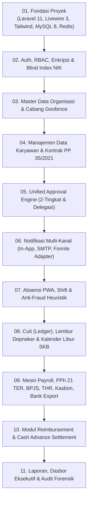

# MASTER INDEKS DOKUMEN PRD — SISTEM PENGELOLAAN KARYAWAN (HRIS)
**Versi:** 1.3.0  
**Tanggal Rilis:** 2 Oktober 2026  
**Status:** Disetujui (Lengkap dengan Rekam Histori Chat & Keputusan Desain)  
**Arsitektur Inti:** Single-Tenant Configurable Platform (Whitelabel/Multi-Company Settings), Laravel 11, Livewire 3 (HTTP/AJAX), MySQL 8, Redis, PWA Mobile ESS, Fonnte WhatsApp Gateway, aaPanel VPS.

---

## 1. Daftar Dokumen PRD Modular

Dokumen PRD ini disusun dalam 15 topik spesifik plus dokumen indeks ini sebagai peta navigasi. Setiap dokumen memuat User Story, Aturan Bisnis Teknis Terverifikasi, Kriteria Penerimaan (*Acceptance Criteria* / Gherkin), Skema Data, dan Pertanyaan/Keputusan Terbuka.

| No | File Dokumen | Judul Dokumen | Fokus Utama & Revisi Terkini |
|---|---|---|---|
| **00** | [`00_INDEX.md`](file:///d:/ARKIN/tes%20aim/docs/prd/00_INDEX.md) | **Master Indeks & Peta Panduan** | Navigasi, matriks dependensi, changelog v1.3.0, dan ringkasan eksekutif. |
| **01** | [`01_RINGKASAN_VISI_ROADMAP.md`](file:///d:/ARKIN/tes%20aim/docs/prd/01_RINGKASAN_VISI_ROADMAP.md) | **Visi, Masalah, Persona & Roadmap** | Masalah, 5 persona pengguna, KPI, roadmap berfase (MVP s.d. Fase 3), mitigasi risiko. |
| **02** | [`02_ARSITEKTUR_DAN_TECH_STACK.md`](file:///d:/ARKIN/tes%20aim/docs/prd/02_ARSITEKTUR_DAN_TECH_STACK.md) | **Arsitektur Sistem & Tech Stack** | Laravel 11, Livewire 3 (HTTP/AJAX), Alpine.js, Tailwind, MySQL 8, Redis, PWA, aaPanel. |
| **03** | [`03_MODEL_DATA_DAN_ERD.md`](file:///d:/ARKIN/tes%20aim/docs/prd/03_MODEL_DATA_DAN_ERD.md) | **Model Data & Database ERD** | Seluruh tabel operasional, kolom profil lengkap, **Blind Index HMAC untuk NIK**, kolom ringkasan payroll, dan audit trail. |
| **04** | [`04_RBAC_KEAMANAN_DAN_UU_PDP.md`](file:///d:/ARKIN/tes%20aim/docs/prd/04_RBAC_KEAMANAN_DAN_UU_PDP.md) | **RBAC, Keamanan & UU PDP** | Matriks izin 5 peran, enkripsi at-rest AES-256-GCM, **Blind Index**, **PIN slip gaji 6-angka mandiri + lockout rate-limit**, dan SOP pencadangan `APP_KEY`. |
| **05** | [`05_MODUL_KARYAWAN_DAN_KONTRAK.md`](file:///d:/ARKIN/tes%20aim/docs/prd/05_MODUL_KARYAWAN_DAN_KONTRAK.md) | **Data Karyawan & Kontrak PP 35/2021** | Batas 5 tahun PKWT, alert H-60/30/7, kalkulator kompensasi berversi, **klarifikasi perlakuan pajak kompensasi (TER vs Final PP 68)**. |
| **06** | [`06_MODUL_ABSENSI_PWA_SHIFT_ANTI_FRAUD.md`](file:///d:/ARKIN/tes%20aim/docs/prd/06_MODUL_ABSENSI_PWA_SHIFT_ANTI_FRAUD.md) | **Absensi PWA, Shift & Anti-Fraud** | Jam server mutlak, kamera live HTML5, **mesin anti-fraud heuristik realistis (teleportasi, device binding, zero-jitter, IP reconciliation)**, bounded offline mode. |
| **07** | [`07_MODUL_CUTI_LEMBUR_KALENDER.md`](file:///d:/ARKIN/tes%20aim/docs/prd/07_MODUL_CUTI_LEMBUR_KALENDER.md) | **Cuti, Lembur & Kalender Perusahaan** | Double-entry ledger cuti, **koreksi multiplier lembur hari libur PP 35/2021 (5 hari vs 6 hari kerja)**, **hak cuti melahirkan UU KIA No. 4/2024 (3+3 bulan upah berjenjang)**. |
| **08** | [`08_MODUL_PAYROLL_PAJAK_BPJS_BANK.md`](file:///d:/ARKIN/tes%20aim/docs/prd/08_MODUL_PAYROLL_PAJAK_BPJS_BANK.md) | **Payroll, PPh 21 TER, BPJS & Bank** | **Koreksi tarif TER A (2.50% untuk bruto Rp 10.423.200 = Rp 260.580)**, **modul THR Permenaker 6/2016**, Gross-up iteratif, ekspor 4 bank (BCA, Mandiri, BRI, BNI), plafon JP berversi. |
| **09** | [`09_MODUL_REIMBURSEMENT_DAN_APPROVAL.md`](file:///d:/ARKIN/tes%20aim/docs/prd/09_MODUL_REIMBURSEMENT_DAN_APPROVAL.md) | **Reimbursement & Approval Engine** | Plafon per jabatan, alur 2-tingkat dengan threshold, delegasi cuti, eskalasi SLA, pencairan on-cycle vs off-cycle, cash advance settlement. |
| **10** | [`10_NOTIFIKASI_DAN_INTEGRASI.md`](file:///d:/ARKIN/tes%20aim/docs/prd/10_NOTIFIKASI_DAN_INTEGRASI.md) | **Notifikasi & Gateway WhatsApp** | Adapter `NotificationChannel`, anti-ban jitter queue Redis, **autentikasi webhook Fonnte valid via URL secret token per tenant**, slip gaji bertoken PIN. |
| **11** | [`11_LAPORAN_DASBOR_DAN_AUDIT_LOG.md`](file:///d:/ARKIN/tes%20aim/docs/prd/11_LAPORAN_DASBOR_DAN_AUDIT_LOG.md) | **Laporan, Dasbor & Audit Log** | Dasbor berbasis peran, laporan matriks kehadiran Excel/PDF, agregasi angka tanpa dekripsi massal, penelusuran forensik audit log. |
| **12** | [`12_SPESIFIKASI_API_DAN_KONTRAK_DATA.md`](file:///d:/ARKIN/tes%20aim/docs/prd/12_SPESIFIKASI_API_DAN_KONTRAK_DATA.md) | **Spesifikasi API & Kontrak Data** | REST endpoints PWA, **protokol Livewire via HTTP/AJAX**, **rate limiting & lockout token slip gaji**, webhook endpoint Fonnte ber-token URL. |
| **13** | [`13_DESAIN_UIUX_DAN_ALUR_LAYAR.md`](file:///d:/ARKIN/tes%20aim/docs/prd/13_DESAIN_UIUX_DAN_ALUR_LAYAR.md) | **Desain UI/UX & Wireflow Layar** | Integrasi 10 referensi visual: Design tokens Tailwind, **alur layar detail Absensi PWA, Pengajuan Cuti, Klaim Biaya, dan Antrean Approval Manajer**. |
| **14** | [`14_PANDUAN_IMPLEMENTASI_TESTING_DEPLOYMENT.md`](file:///d:/ARKIN/tes%20aim/docs/prd/14_PANDUAN_IMPLEMENTASI_TESTING_DEPLOYMENT.md) | **Panduan Implementasi, Test & aaPanel** | **Koreksi urutan build (Approval & Notifikasi sebelum Cuti/Lembur)**, Pest unit testing finansial terverifikasi, setup Nginx, PHP 8.3 & Supervisor di aaPanel. |
| **16** | [`16_HISTORI_CHAT.md`](file:///d:/ARKIN/tes%20aim/docs/prd/16_HISTORI_CHAT.md) | **Histori Chat & Rekam Keputusan Desain** | **Transkrip lengkap:** Kronologi musyawarah, tanya-jawab grill-me, analisis 10 gambar referensi UI, rekap temuan peer-review, dan rationale keputusan. |

---

## 2. Urutan Bangun Modul Bebas Ketergantungan (Build Pipeline)

---

## 3. Changelog Perbaikan & Penyempurnaan

* **v1.3.0 (2 Oktober 2026):**
  * **Penambahan Dokumen 16 (Histori Chat):** Mendokumentasikan secara lengkap seluruh kronologi musyawarah, wawancara grill-me, analisis 10 referensi UI/UX, dan tindak lanjut peer-review ke dalam berkas [`16_HISTORI_CHAT.md`](file:///d:/ARKIN/tes%20aim/docs/prd/16_HISTORI_CHAT.md).
* **v1.2.0 (2 Oktober 2026):**
  * Koreksi tarif TER A (2.50%), multiplier lembur PP 35/2021, cuti melahirkan UU KIA 2024, THR Permenaker 6/2016, PIN slip gaji 6-angka mandiri + lockout, Blind Index HMAC untuk NIK, skema 12 tabel basis data, webhook Fonnte URL secret, urutan build, dan wireflow layar.
