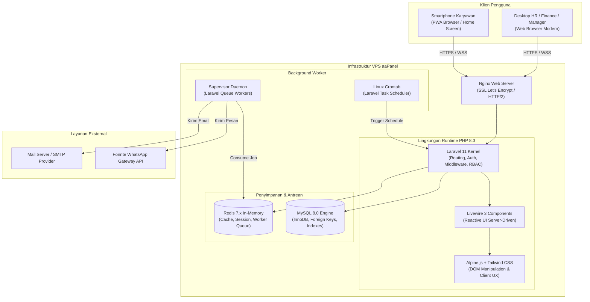
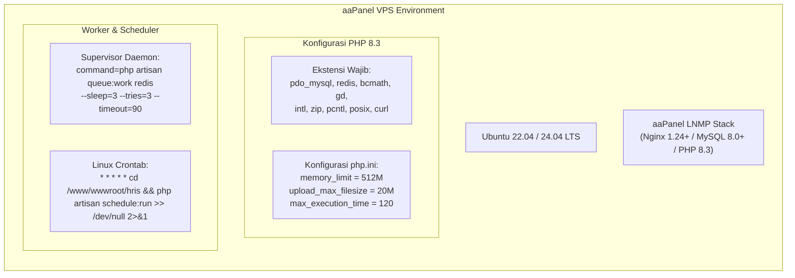

# PRD 02 — ARSITEKTUR SISTEM & TECH STACK
**Versi:** 1.0.0  
**Tanggal:** 2 Oktober 2026  
**Status:** Disetujui  
**Rujukan Dokumen:** [`00_INDEX.md`](file:///d:/ARKIN/tes%20aim/docs/prd/00_INDEX.md), [`01_RINGKASAN_VISI_ROADMAP.md`](file:///d:/ARKIN/tes%20aim/docs/prd/01_RINGKASAN_VISI_ROADMAP.md)

---

## 1. Arsitektur Tingkat Tinggi (High-Level Architecture)

Sistem dirancang dengan arsitektur **Monolitik Modular (Modular Monolith)** berbasis **Single-Tenant Configurable Platform**. Model ini memberikan kedaulatan data penuh bagi organisasi, mempermudah pemeliharaan, serta meniadakan risiko kebocoran data antar-perusahaan (*cross-tenant leakage*), sambil tetap menyediakan fleksibilitas kustomisasi identitas perusahaan (*whitelabel metadata*).

---

## 2. Pemilihan & Spesifikasi Tech Stack

| Lapisan (Layer) | Teknologi Terpilih | Versi Minimum | Rationale & Keunggulan |
|---|---|---|---|
| **Backend Framework** | Laravel Framework | 11.x | Ekosistem sangat kaya untuk enterprise, bawaan Queue System tangguh, ORM Eloquent ekspresif, manajemen migration terstruktur, dan fitur keamanan bawaan (CSRF, XSS, SQLi protection). |
| **Bahasa Pemrograman** | PHP | 8.3+ | Performa JIT compiler tinggi, typing system modern, konsumsi memori stabil, kompatibilitas optimal dengan VPS aaPanel. |
| **Frontend Reactive** | Laravel Livewire | 3.x | Memungkinkan antarmuka reaktif dinamis (SPA-like) tanpa perlu membangun REST API terpisah dan tanpa overhead bundle JavaScript berlebih. |
| **Interaktivitas Klien** | Alpine.js | 3.x | Sangat ringan (< 15KB) untuk interaktivitas DOM sisi browser (kamera selfie, geolokasi GPS, modal popup, tabs, dropdown). |
| **Desain & Styling** | Tailwind CSS | 3.4+ / 4.x | Utility-first CSS framework untuk membangun UI responsif desktop dan mobile-first PWA yang konsisten, bersih, dan cepat dimuat. |
| **Basis Data Relasional** | MySQL Server | 8.0+ | Engine InnoDB, dukungan JSON columns untuk audit log dan payload dinamis, integritas *Foreign Key*, performa *indexing* tinggi. |
| **In-Memory & Antrean** | Redis Server | 7.0+ | Manajemen antrean (*queue broker*) pengiriman notifikasi, eksekusi kalkulasi payroll massal, serta caching sesi pengguna. |
| **PWA & Offline Client** | Service Worker + IndexedDB | Standar W3C | Menyimpan shell aplikasi di cache ponsel, mendeteksi konektivitas jaringan, serta menampung absen offline darurat sebelum disinkronkan. |
| **PDF Generator** | Barryvdh DomPDF / Snappy | Versi Terbaru | Menghasilkan dokumen slip gaji resmi (ber-password PIN), surat kontrak kerja, dan laporan rekapitulasi secara server-side. |
| **Excel / CSV Engine** | Maatwebsite / Spatie Simple Excel | Versi Terbaru | Mampu membaca dan mengekspor ribuan baris data karyawan dan rekap absensi dengan konsumsi memori rendah (*chunked streaming*). |
| **WhatsApp Gateway** | Fonnte API | HTTP REST v1 | Gateway WhatsApp populer di Indonesia, mendukung token per instansi, pengiriman teks, dokumen PDF, dan penanganan webhook. |

---

## 3. Arsitektur Komponen PWA (Progressive Web App)

Aplikasi Karyawan (ESS) tidak mewajibkan instalasi aplikasi biner (APK/IPA) dari toko aplikasi publik, melainkan beroperasi sebagai **Progressive Web App**:
1. **Manifest File (`manifest.json`):** Mendefinisikan nama aplikasi, tema warna korporat, ikon aplikasi resolusi tinggi, orientasi potret, serta mode tampilan `standalone` (menghilangkan bilah navigasi browser sehingga tampak seperti aplikasi native).
2. **Service Worker (`sw.js`):**
   * *Pre-caching:* Menyimpan aset statis utama (CSS, JS, logo, font) secara offline.
   * *Network-First Strategy:* Untuk permintaan data dinamis (saldo cuti, status absen hari ini).
   * *Background Sync / Fallback:* Menangkap kegagalan jaringan saat absen dan menyimpan payload sementara ke IndexedDB.
3. **Hardware Access via Web APIs:**
   * **Kamera:** Mengakses kamera depan melalui API `navigator.mediaDevices.getUserMedia({ video: { facingMode: "user" } })` untuk mengambil foto selfie langsung tanpa membuka galeri perangkat.
   * **GPS:** Mengakses koordinat presisi tinggi melalui `navigator.geolocation.getCurrentPosition({ enableHighAccuracy: true, timeout: 10000, maximumAge: 0 })`.
   * **Integritas Waktu:** PWA tidak pernah mempercayai waktu lokal perangkat (`new Date()`). Waktu absensi selalu dihitung dan dicap oleh server backend Laravel melalui response HTTP header atau websocket heartbeat.

---

## 4. Pola Desain Perangkat Lunak (Software Design Patterns)

Untuk memastikan skalabilitas dan kemudahan pengujian unit/fitur, kode disusun dengan pola:
1. **Service Repository Pattern:** Memisahkan logika bisnis kompleks dari Controller/Livewire Component.
   * `PayrollCalculationService`: Bertanggung jawab atas seluruh komputasi PPh 21 TER, BPJS, lembur, dan denda.
   * `AttendanceValidationService`: Memvalidasi koordinat geofence, akurasi GPS, jam operasional shift, dan deteksi anomali.
   * `LeaveLedgerService`: Mengelola pembukuan debit-kredit kuota cuti.
2. **Notification Channel Adapter Pattern:**
   * Mendefinisikan antarmuka kontrak `NotificationChannelInterface` dengan implementasi `EmailNotificationChannel`, `FonnteWhatsAppChannel`, dan `InAppNotificationChannel`.
   * Pergantian provider WhatsApp (misal di masa depan beralih ke Meta Official Cloud API) tidak akan mengubah kode bisnis aplikasi.
3. **Versioned Strategy Pattern:**
   * Formula pajak PPh 21 dan tarif BPJS diimplementasikan sebagai *Strategy Classes* yang dipetakan berdasarkan tanggal berlaku (*Effective Date*).

---

## 5. Spesifikasi Lingkungan Deployment VPS aaPanel

Konfigurasi server produksi direkomendasikan berjalan pada VPS (Virtual Private Server) berbasis Linux Ubuntu LTS dengan kontrol panel aaPanel:

### 5.1 Parameter Optimasi Nginx
* **Gzip & Brotli Compression:** Aktif untuk aset statis (CSS, JS, SVG, JSON).
* **Client Body Buffer:** `client_max_body_size 20M;` untuk memfasilitasi unggah lampiran dokumen dan foto selfie absensi.
* **FastCGI Cache:** Khusus untuk halaman statis non-autentikasi.
* **Keamanan Header:** `X-Frame-Options SAMEORIGIN`, `X-Content-Type-Options nosniff`, `Referrer-Policy strict-origin-when-cross-origin`.

---

## 6. Kriteria Kesiapan Non-Fungsional (Non-Functional Requirements)

1. **Kecepatan Respons (Latency):**
   * Panggilan absensi PWA: $\le 800$ ms.
   * Pemuatan dasbor utama HR: $\le 1.5$ detik.
   * Waktu kalkulasi payroll untuk 1.000 karyawan: $\le 45$ detik (diproses dalam *chunked background job*).
2. **Ketersediaan & Keandalan (Reliability):**
   * Target SLA Uptime: $\ge 99.8\%$.
   * Auto-restart worker queue oleh Supervisor jika terjadi kegagalan proses memori.
3. **Keamanan Data (Data Security):**
   * Seluruh komunikasi wajib terenkripsi menggunakan HTTPS (TLS 1.3).
   * Nilai gaji, nomor rekening bank, dan NIK KTP dienkripsi di level basis data menggunakan algoritma AES-256-GCM.
