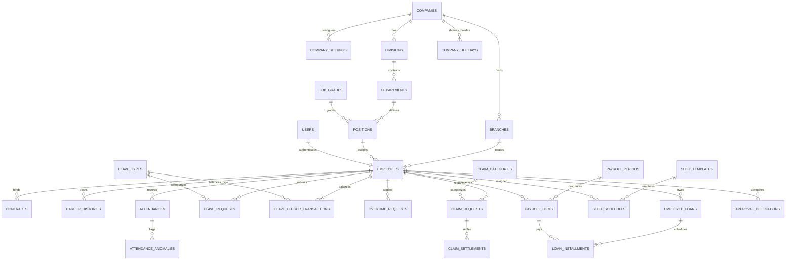

# PRD 03 — MODEL DATA, SKEMA RELASIONAL & DATABASE ERD
**Versi:** 1.1.0  
**Tanggal:** 2 Oktober 2026  
**Status:** Disetujui (Telah Direvisi Menyeluruh dengan Seluruh Tabel & Kolom Lengkap)  
**Rujukan Dokumen:** [`00_INDEX.md`](file:///d:/ARKIN/tes%20aim/docs/prd/00_INDEX.md), [`02_ARSITEKTUR_DAN_TECH_STACK.md`](file:///d:/ARKIN/tes%20aim/docs/prd/02_ARSITEKTUR_DAN_TECH_STACK.md), [`04_RBAC_KEAMANAN_DAN_UU_PDP.md`](file:///d:/ARKIN/tes%20aim/docs/prd/04_RBAC_KEAMANAN_DAN_UU_PDP.md)

---

## 1. Prinsip Desain Basis Data & Solusi Kolom Terenkripsi

1. **Pola Blind Index (HMAC-SHA256) untuk Pencarian Kolom Terenkripsi:**
   Kolom yang dienkripsi dengan AES-256-GCM (seperti `nik_ktp`) menghasilkan ciphertext yang acak dan tidak dapat dicari menggunakan kueri SQL `WHERE nik_ktp = '...'` ataupun dikenakan indeks unik (*unique constraint*).
   * **Solusi Sistem:** Setiap kolom terenkripsi yang membutuhkan pencarian atau jaminan keunikan dipasangkan dengan kolom **Blind Index** (misal: `nik_bidx = hash_hmac('sha256', $nik, $blind_index_key)`). Kueri pencarian dilakukan terhadap kolom hash deterministik ini.
2. **Tabel Ringkasan untuk Agregasi Finansial Tanpa Dekripsi Massal:**
   Tabel `payroll_periods` menyimpan agregat angka total (`total_gross_pay`, `total_net_pay`, `total_tax`, `total_bpjs_company`) yang dikalkulasi saat finalisasi periode, sehingga laporan metrik dasbor dapat ditarik instan dengan kueri agregasi SQL tanpa mendeskripsi ribuan baris data karyawan di memori PHP.
3. **Pola Buku Besar Ganda (Double-Entry Ledger):** Mutasi saldo cuti dan cicilan pinjaman dicatat transaksional.
4. **Pola Effective Dating (Tanggal Berlaku Riwayat):** Riwayat mutasi dan promosi disimpan berpenanggalan.
5. **Prosedur Pencadangan Mandiri `APP_KEY`:** Kunci enkripsi wajib dicadangkan secara terpisah di brankas aman (*Vault*).

---

## 2. Diagram Hubungan Entitas Lengkap (Comprehensive ERD)

---

## 3. Spesifikasi Kamus Data Seluruh Tabel (Data Dictionary)

### 3.1 Grup Organisasi & Struktur Perusahaan

#### Tabel `companies`
* `id`: BIGINT UNSIGNED AUTO_INCREMENT PRIMARY KEY
* `name`: VARCHAR(255) NOT NULL
* `legal_name`: VARCHAR(255) NULL
* `tax_id_npwp`: VARCHAR(50) NULL
* `email`: VARCHAR(150) NULL
* `phone`: VARCHAR(50) NULL
* `address`: TEXT NULL
* `logo_url`: VARCHAR(255) NULL
* `created_at`, `updated_at`

#### Tabel `branches`
* `id`: BIGINT UNSIGNED AUTO_INCREMENT PRIMARY KEY
* `company_id`: BIGINT UNSIGNED NOT NULL (FK ke `companies.id`)
* `branch_code`: VARCHAR(50) UNIQUE NOT NULL
* `name`: VARCHAR(150) NOT NULL
* `latitude`: DECIMAL(10, 8) NOT NULL
* `longitude`: DECIMAL(11, 8) NOT NULL
* `geofence_radius_meters`: INT UNSIGNED DEFAULT 100
* `address`: TEXT NULL
* `is_active`: BOOLEAN DEFAULT TRUE
* `created_at`, `updated_at`

#### Tabel `divisions` (Divisi)
* `id`: BIGINT UNSIGNED AUTO_INCREMENT PRIMARY KEY
* `company_id`: BIGINT UNSIGNED NOT NULL (FK)
* `name`: VARCHAR(150) NOT NULL
* `created_at`, `updated_at`

#### Tabel `departments` (Departemen)
* `id`: BIGINT UNSIGNED AUTO_INCREMENT PRIMARY KEY
* `division_id`: BIGINT UNSIGNED NOT NULL (FK ke `divisions.id`)
* `name`: VARCHAR(150) NOT NULL
* `created_at`, `updated_at`

#### Tabel `job_grades` (Level / Golongan Jabatan)
* `id`: BIGINT UNSIGNED AUTO_INCREMENT PRIMARY KEY
* `grade_name`: VARCHAR(50) NOT NULL (mis. "Grade 1 - Staff", "Grade 4 - Manager")
* `level_order`: INT UNSIGNED NOT NULL
* `min_salary`: DECIMAL(12, 2) NULL
* `max_salary`: DECIMAL(12, 2) NULL
* `created_at`, `updated_at`

#### Tabel `positions` (Jabatan)
* `id`: BIGINT UNSIGNED AUTO_INCREMENT PRIMARY KEY
* `department_id`: BIGINT UNSIGNED NOT NULL (FK ke `departments.id`)
* `job_grade_id`: BIGINT UNSIGNED NOT NULL (FK ke `job_grades.id`)
* `title`: VARCHAR(150) NOT NULL
* `created_at`, `updated_at`

---

### 3.2 Grup Pengguna, Karyawan Lengkap & Kontrak

#### Tabel `users`
* `id`: BIGINT UNSIGNED AUTO_INCREMENT PRIMARY KEY
* `name`: VARCHAR(150) NOT NULL
* `email`: VARCHAR(150) UNIQUE NOT NULL
* `phone_number`: VARCHAR(50) UNIQUE NULL
* `password`: VARCHAR(255) NOT NULL
* `role`: ENUM('super_admin', 'hr_admin', 'manager', 'finance', 'employee') NOT NULL
* `is_active`: BOOLEAN DEFAULT TRUE
* `payslip_pin_hash`: VARCHAR(255) NULL (Hash PIN rahasia 6 angka untuk buka slip gaji)
* `device_fingerprint`: VARCHAR(255) NULL
* `device_name`: VARCHAR(150) NULL
* `device_bound_at`: TIMESTAMP NULL
* `created_at`, `updated_at`

#### Tabel `employees` (Profil Lengkap Karyawan)
* `id`: BIGINT UNSIGNED AUTO_INCREMENT PRIMARY KEY
* `user_id`: BIGINT UNSIGNED UNIQUE NOT NULL (FK ke `users.id`)
* `employee_code`: VARCHAR(50) UNIQUE NOT NULL (NIK Pegawai)
* `full_name`: VARCHAR(200) NOT NULL
* `nickname`: VARCHAR(100) NULL
* `nik_ktp`: TEXT NOT NULL (Enkripsi AES-256-GCM)
* `nik_bidx`: VARCHAR(64) UNIQUE NOT NULL (HMAC-SHA256 Blind Index untuk pencarian instan)
* `birth_place`: VARCHAR(100) NOT NULL
* `birth_date`: DATE NOT NULL
* `gender`: ENUM('male', 'female') NOT NULL
* `marital_status`: ENUM('single', 'married', 'widowed', 'divorced') NOT NULL
* `blood_type`: VARCHAR(5) NULL
* `address`: TEXT NOT NULL
* `emergency_contacts`: JSON NULL (Nama, hubungan, nomor HP kontak darurat)
* `branch_id`: BIGINT UNSIGNED NOT NULL (FK ke `branches.id`)
* `department_id`: BIGINT UNSIGNED NOT NULL (FK ke `departments.id`)
* `position_id`: BIGINT UNSIGNED NOT NULL (FK ke `positions.id`)
* `manager_id`: BIGINT UNSIGNED NULL (Self-referencing FK ke `employees.id`)
* `employment_status`: ENUM('pkwt', 'pkwtt', 'probation', 'internship', 'freelance') NOT NULL
* `join_date`: DATE NOT NULL
* `permanent_date`: DATE NULL
* `end_contract_date`: DATE NULL
* `bank_name`: VARCHAR(100) NOT NULL
* `bank_account_holder`: VARCHAR(150) NOT NULL
* `bank_account_number`: TEXT NOT NULL (Enkripsi AES-256-GCM)
* `npwp_number`: TEXT NULL (Enkripsi AES-256-GCM)
* `ptkp_status`: ENUM('TK/0', 'TK/1', 'TK/2', 'TK/3', 'K/0', 'K/1', 'K/2', 'K/3') NOT NULL
* `dependent_count`: TINYINT UNSIGNED DEFAULT 0
* `bpjs_kes_number`: TEXT NULL (Enkripsi AES-256-GCM)
* `bpjs_tk_number`: TEXT NULL (Enkripsi AES-256-GCM)
* `created_at`, `updated_at`, `deleted_at`

---

### 3.3 Grup Cuti, Lembur, Kalender & Libur

#### Tabel `leave_types`
* `id`: BIGINT UNSIGNED AUTO_INCREMENT PRIMARY KEY
* `code`: VARCHAR(50) UNIQUE NOT NULL (mis. `ANNUAL`, `MATERNITY`, `PATERNITY`, `SICK`, `MARRIAGE`)
* `name`: VARCHAR(100) NOT NULL
* `default_quota`: DECIMAL(4, 2) NOT NULL (contoh: 12.00)
* `is_paid`: BOOLEAN DEFAULT TRUE
* `requires_attachment`: BOOLEAN DEFAULT FALSE
* `created_at`, `updated_at`

#### Tabel `leave_ledger_transactions`
* `id`: BIGINT UNSIGNED AUTO_INCREMENT PRIMARY KEY
* `employee_id`: BIGINT UNSIGNED NOT NULL (FK ke `employees.id`)
* `leave_type_id`: BIGINT UNSIGNED NOT NULL (FK ke `leave_types.id`)
* `transaction_type`: ENUM('entitlement_grant', 'monthly_accrual', 'leave_taken', 'leave_cancelled_refund', 'carry_over_expired', 'manual_adjustment') NOT NULL
* `amount`: DECIMAL(4, 2) NOT NULL
* `balance_after`: DECIMAL(5, 2) NOT NULL
* `reference_id`: BIGINT UNSIGNED NULL
* `notes`: VARCHAR(255) NULL
* `created_at`

#### Tabel `leave_requests`
* `id`: BIGINT UNSIGNED AUTO_INCREMENT PRIMARY KEY
* `employee_id`: BIGINT UNSIGNED NOT NULL (FK)
* `leave_type_id`: BIGINT UNSIGNED NOT NULL (FK)
* `start_date`: DATE NOT NULL
* `end_date`: DATE NOT NULL
* `total_days`: DECIMAL(4, 2) NOT NULL
* `reason`: TEXT NOT NULL
* `attachment_path`: VARCHAR(255) NULL
* `approval_stage`: ENUM('level_1_manager', 'level_2_hr', 'completed', 'rejected') NOT NULL
* `status`: ENUM('pending', 'approved', 'rejected', 'cancelled') DEFAULT 'pending'
* `rejection_reason`: TEXT NULL
* `created_at`, `updated_at`

#### Tabel `overtime_requests` (Surat Perintah Kerja Lembur - SPKL)
* `id`: BIGINT UNSIGNED AUTO_INCREMENT PRIMARY KEY
* `employee_id`: BIGINT UNSIGNED NOT NULL (FK)
* `date`: DATE NOT NULL
* `start_time`: TIME NOT NULL
* `end_time`: TIME NOT NULL
* `realized_start_time`: TIME NULL
* `realized_end_time`: TIME NULL
* `total_hours`: DECIMAL(4, 2) NOT NULL
* `calculated_pay`: DECIMAL(12, 2) DEFAULT 0
* `work_description`: TEXT NOT NULL
* `status`: ENUM('pending', 'approved', 'rejected') DEFAULT 'pending'
* `created_at`, `updated_at`

#### Tabel `company_holidays` (Kalender Libur & Acara)
* `id`: BIGINT UNSIGNED AUTO_INCREMENT PRIMARY KEY
* `holiday_date`: DATE NOT NULL
* `name`: VARCHAR(200) NOT NULL
* `type`: ENUM('national_holiday', 'cuti_bersama', 'company_event', 'branch_holiday') NOT NULL
* `branch_id`: BIGINT UNSIGNED NULL (Null jika berlaku untuk seluruh perusahaan)
* `is_paid`: BOOLEAN DEFAULT TRUE
* `created_at`, `updated_at`

---

### 3.4 Grup Reimbursement & Persetujuan (Approval)

#### Tabel `claim_categories`
* `id`: BIGINT UNSIGNED AUTO_INCREMENT PRIMARY KEY
* `name`: VARCHAR(100) NOT NULL (Transport, Medis, Operasional, Makan)
* `is_taxable`: BOOLEAN DEFAULT FALSE
* `created_at`, `updated_at`

#### Tabel `claim_requests`
* `id`: BIGINT UNSIGNED AUTO_INCREMENT PRIMARY KEY
* `employee_id`: BIGINT UNSIGNED NOT NULL (FK)
* `claim_category_id`: BIGINT UNSIGNED NOT NULL (FK)
* `transaction_date`: DATE NOT NULL
* `amount`: DECIMAL(12, 2) NOT NULL
* `receipt_path`: VARCHAR(255) NOT NULL
* `description`: TEXT NOT NULL
* `disbursement_method`: ENUM('payroll_merge', 'off_cycle_direct') NOT NULL
* `payment_status`: ENUM('unpaid', 'paid_payroll', 'paid_off_cycle') DEFAULT 'unpaid'
* `payment_reference`: VARCHAR(100) NULL
* `paid_at`: TIMESTAMP NULL
* `status`: ENUM('pending_level_1', 'pending_finance', 'approved', 'rejected') DEFAULT 'pending_level_1'
* `created_at`, `updated_at`

#### Tabel `claim_settlements` (Penyelesaian Advance / Kasbon Dinas)
* `id`: BIGINT UNSIGNED AUTO_INCREMENT PRIMARY KEY
* `claim_request_id`: BIGINT UNSIGNED NOT NULL (FK)
* `advance_amount`: DECIMAL(12, 2) NOT NULL
* `actual_amount`: DECIMAL(12, 2) NOT NULL
* `difference_amount`: DECIMAL(12, 2) NOT NULL
* `settlement_status`: ENUM('settled', 'refund_to_company', 'reimburse_to_employee') NOT NULL
* `created_at`, `updated_at`

#### Tabel `approval_delegations` (Delegasi Wewenang Manajer)
* `id`: BIGINT UNSIGNED AUTO_INCREMENT PRIMARY KEY
* `manager_id`: BIGINT UNSIGNED NOT NULL (FK ke `employees.id` - Pemberi Delegasi)
* `delegate_id`: BIGINT UNSIGNED NOT NULL (FK ke `employees.id` - Penerima Delegasi)
* `start_date`: DATE NOT NULL
* `end_date`: DATE NOT NULL
* `reason`: VARCHAR(255) NOT NULL
* `is_active`: BOOLEAN DEFAULT TRUE
* `created_at`, `updated_at`

---

### 3.5 Grup Payroll, Pajak Berversi & Audit

#### Tabel `tax_ter_brackets` (Tabel Tarif TER PP 58/2023 Berversi)
* `id`: BIGINT UNSIGNED AUTO_INCREMENT PRIMARY KEY
* `ter_category`: ENUM('TER_A', 'TER_B', 'TER_C') NOT NULL
* `min_gross_income`: DECIMAL(12, 2) NOT NULL
* `max_gross_income`: DECIMAL(12, 2) NOT NULL
* `rate_percentage`: DECIMAL(5, 2) NOT NULL
* `effective_start_date`: DATE NOT NULL
* `created_at`, `updated_at`

#### Tabel `bpjs_configurations` (Konfigurasi Tarif & Plafon BPJS Berversi)
* `id`: BIGINT UNSIGNED AUTO_INCREMENT PRIMARY KEY
* `program_name`: VARCHAR(50) NOT NULL (mis. `BPJS_KES`, `BPJS_TK_JP`, `BPJS_TK_JKK`)
* `company_rate`: DECIMAL(5, 2) NOT NULL
* `employee_rate`: DECIMAL(5, 2) NOT NULL
* `salary_cap_max`: DECIMAL(12, 2) NULL (mis. Rp 10.042.300 untuk JP)
* `effective_date`: DATE NOT NULL
* `created_at`, `updated_at`

#### Tabel `payroll_periods` (Dengan Kolom Ringkasan Agregat)
* `id`: BIGINT UNSIGNED AUTO_INCREMENT PRIMARY KEY
* `period_name`: VARCHAR(100) NOT NULL
* `attendance_start_date`: DATE NOT NULL
* `attendance_end_date`: DATE NOT NULL
* `payment_date`: DATE NOT NULL
* `status`: ENUM('draft', 'simulated', 'finalized', 'locked') DEFAULT 'draft'
* `total_gross_pay`: DECIMAL(15, 2) DEFAULT 0
* `total_net_pay`: DECIMAL(15, 2) DEFAULT 0
* `total_pph21_tax`: DECIMAL(15, 2) DEFAULT 0
* `total_bpjs_company`: DECIMAL(15, 2) DEFAULT 0
* `total_bpjs_employee`: DECIMAL(15, 2) DEFAULT 0
* `locked_at`: TIMESTAMP NULL
* `locked_by`: BIGINT UNSIGNED NULL
* `created_at`, `updated_at`

#### Tabel `audit_logs` (Forensik Aktivitas Sistem)
* `id`: BIGINT UNSIGNED AUTO_INCREMENT PRIMARY KEY
* `user_id`: BIGINT UNSIGNED NULL
* `action`: VARCHAR(100) NOT NULL (mis. `update_salary`, `reset_device`, `view_sensitive_data`)
* `model_type`: VARCHAR(150) NOT NULL
* `model_id`: BIGINT UNSIGNED NOT NULL
* `old_values`: JSON NULL
* `new_values`: JSON NULL
* `ip_address`: VARCHAR(45) NOT NULL
* `user_agent`: TEXT NULL
* `created_at`: TIMESTAMP NOT NULL DEFAULT CURRENT_TIMESTAMP

#### Tabel `notification_logs`
* `id`: BIGINT UNSIGNED AUTO_INCREMENT PRIMARY KEY
* `recipient_id`: BIGINT UNSIGNED NOT NULL
* `channel`: ENUM('in_app', 'email', 'whatsapp') NOT NULL
* `payload`: TEXT NOT NULL
* `status`: ENUM('queued', 'delivered', 'failed') DEFAULT 'queued'
* `error_message`: TEXT NULL
* `created_at`, `updated_at`
