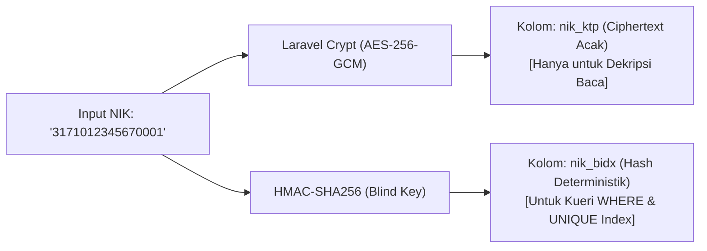

# PRD 04 — RBAC, KEAMANAN DATA, BLIND INDEX & UU PDP
**Versi:** 1.1.0  
**Tanggal:** 2 Oktober 2026  
**Status:** Disetujui (Telah Direvisi: Blind Index NIK, Keamanan PIN Slip Gaji, & Protokol Kunci)  
**Rujukan Dokumen:** [`00_INDEX.md`](file:///d:/ARKIN/tes%20aim/docs/prd/00_INDEX.md), [`03_MODEL_DATA_DAN_ERD.md`](file:///d:/ARKIN/tes%20aim/docs/prd/03_MODEL_DATA_DAN_ERD.md)

---

## 1. Landasan Hukum: Kepatuhan UU Perlindungan Data Pribadi (UU PDP No. 27/2022)

Pemrosesan data kepegawaian tunduk pada ketentuan hukum perlindungan data pribadi Indonesia:
1. **Dasar Hukum Pemrosesan (Pasal 20):** Dilakukan atas dasar pemenuhan hak dan kewajiban perjanjian kerja resmi serta kepatuhan perpajakan/ketenagakerjaan.
2. **Minimalisasi Data (Pasal 16):** Data yang dihimpun hanya sebatas kebutuhan administrasi ketenagakerjaan.
3. **Penyimpanan Aman (Pasal 35):** Wajib menerapkan langkah teknis untuk melindungi data pribadi dari akses tanpa hak.

---

## 2. Arsitektur Enkripsi & Solusi Pencarian Blind Index

### 2.1 Masalah Enkripsi Non-Deterministik (AES-256-GCM)
Enkripsi standar Laravel menggunakan AES-256-GCM dengan *Initialization Vector* (IV) acak. Nilai string "3171012345670001" yang dienkripsi 2 kali akan menghasilkan 2 string ciphertext yang sama sekali berbeda. Konsekuensinya:
* Tidak dapat dicari dengan kueri SQL `SELECT * FROM employees WHERE nik_ktp = '...'`.
* Tidak dapat dipasang indeks unik bawaan database (*Unique Constraint*).

### 2.2 Solusi Blind Index (HMAC-SHA256)
Sistem memisahkan kolom penyimpanan rahasia dan kolom indeks pencarian:
1. **Kolom Penyimpanan Rahasia (`nik_ktp`):** Berisi ciphertext AES-256-GCM yang hanya dapat didekripsi oleh aplikasi untuk ditampilkan di profil atau dicetak ke slip gaji.
2. **Kolom Indeks Pencarian (`nik_bidx`):** Berisi nilai hash deterministik satu arah:
   $$\text{nik\_bidx} = \text{HMAC-SHA256}(\text{nik\_bersih}, \text{BLIND\_INDEX\_KEY})$$
   * Nilai hash ini unik dan konsisten untuk setiap NIK.
   * Dipasang indeks `UNIQUE` di MySQL untuk mencegah pendaftaran NIK ganda.
   * Kueri pencarian karyawan berdasarkan NIK dilakukan dengan mencari `nik_bidx`.

---

## 3. Protokol Pemulihan Bencana Kunci Aplikasi (`APP_KEY` Disaster Recovery)

> [!CAUTION]
> **Risiko Fatal Kehilangan Kunci:** Kunci aplikasi (`APP_KEY`) di file `.env` adalah satu-satunya kunci untuk membuka seluruh data gaji, nomor rekening bank, dan NIK karyawan yang tersimpan di basis data. Jika `APP_KEY` terhapus atau tertimpa oleh `php artisan key:generate` yang tidak disengaja, **seluruh data finansial historis perusahaan akan hilang permanen tanpa dapat didekripsi kembali**.

### Standar Operasional Prosedur (SOP) Kunci:
1. **Pencadangan Fisik:** Kunci `APP_KEY` dan `BLIND_INDEX_KEY` wajib dicadangkan secara terpisah di brankas kata sandi aman (seperti Bitwarden, 1Password, atau HashiCorp Vault) milik pimpinan IT/manajemen perusahaan.
2. **Proteksi File `.env` di aaPanel:** File `.env` pada server produksi diberi hak akses ketat `chmod 400` atau `chmod 600` milik user `www`, dan dilarang masuk ke repositori Git (`.gitignore`).

---

## 4. Keamanan PIN Slip Gaji (Pemberantasan Celah Tebakan)

Merespons evaluasi bahwa kombinasi NIK + tanggal lahir mudah ditebak rekan kerja:
1. **PIN Rahasia Mandiri (Employee Custom PIN):**
   * Karyawan wajib menyetel **PIN Rahasia 6 Angka** sendiri saat pertama kali login ke portal ESS.
   * PIN disimpan dalam format hash satu arah Bcrypt di tabel `users.payslip_pin_hash`.
2. **Perlindungan Brute-Force & Lockout:**
   * Percobaan membuka slip gaji dibatasi maksimal **3 kali gagal**.
   * Jika gagal 3 kali, akses token terkunci otomatis selama **15 menit**, dan sistem mengirimkan email notifikasi insiden keamanan ke pemilik akun.

---

## 5. Matriks Hak Akses (Role-Based Access Control)

| Modul / Fitur | Super Admin | HR Admin | Line Manager | Finance Admin | Karyawan (ESS) |
|---|:---:|:---:|:---:|:---:|:---:|
| Konfigurasi & Kunci Tenant | **CRUD Penuh** | Hanya Baca | Ditolak | Ditolak | Ditolak |
| Master Data Karyawan & Kontrak | Audit Baca | **CRUD Penuh** | Hanya Tim Sendiri | Hanya Data Bank/Pajak | Profil Sendiri |
| Absensi: Rekap & Anomali | Audit Baca | **Kelola & Approve** | Rekap Tim | Rekap Baca | Absen Sendiri |
| Approval Cuti / Lembur / Klaim | Bypass Darurat | **Approval Tingkat 2** | **Approval Tingkat 1** | Approval Fin > Limit | Ditolak |
| Proses Payroll & Ekspor Bank | Ditolak | Draf & Simulasi | Ditolak | **Kunci & Ekspor File** | Ditolak |
| Akses Slip Gaji PDF | Ditolak | Seluruh Slip | Ditolak | Seluruh Slip | **Milik Sendiri (PIN)** |
| Reset Device Binding Karyawan | Eksekusi | **Eksekusi Utama** | Ditolak | Ditolak | Ditolak |

---

## 6. Pertanyaan Terbuka & Keputusan Lanjutan ⚠️

1. **Kebijakan Reset PIN Slip Gaji:** Jika karyawan lupa PIN rahasia 6 angkanya, apakah reset PIN dilakukan mandiri via kode OTP WhatsApp/Email, atau harus melalui tiket permohonan ke HR Admin?
2. **Retensi Penghapusan Data Mantan Karyawan:** Sesuai UU PDP (Hak Penghapusan Data), setelah berapa tahun data mantan karyawan boleh di-anonimkan (mengorbankan histori laporan pajak masa lalu)? Disarankan minimal 5–10 tahun sesuai UU Dokumen Perusahaan.
