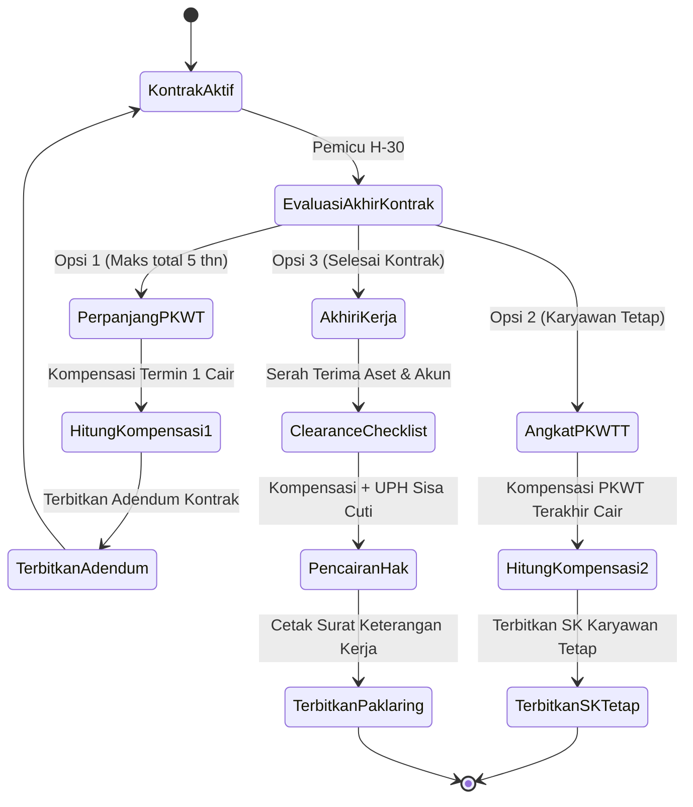

# PRD 05 — MODUL KARYAWAN & KONTRAK PKWT/PKWTT (PP 35/2021)
**Versi:** 1.1.0  
**Tanggal:** 2 Oktober 2026  
**Status:** Disetujui (Telah Direvisi: Klarifikasi Pajak Kompensasi & Skema Konfigurasi Berversi)  
**Rujukan Dokumen:** [`00_INDEX.md`](file:///d:/ARKIN/tes%20aim/docs/prd/00_INDEX.md), [`03_MODEL_DATA_DAN_ERD.md`](file:///d:/ARKIN/tes%20aim/docs/prd/03_MODEL_DATA_DAN_ERD.md), [`04_RBAC_KEAMANAN_DAN_UU_PDP.md`](file:///d:/ARKIN/tes%20aim/docs/prd/04_RBAC_KEAMANAN_DAN_UU_PDP.md)

---

## 1. Deskripsi Modul & Sasaran Bisnis

Modul Karyawan mengelola siklus hidup data induk kepegawaian, struktur organisasi, mutasi/promosi, hingga pemenuhan regulasi ketenagakerjaan **PP No. 35 Tahun 2021** terkait Perjanjian Kerja Waktu Tertentu (PKWT) dan Tetap (PKWTT).

---

## 2. Kepatuhan Regulasi Kontrak PKWT (PP 35/2021)

1. **Batas Maksimal 5 Tahun Total:** Akumulasi kontrak PKWT awal beserta seluruh perpanjangannya dibatasi maksimal 60 bulan (5 tahun). Melebihi batas ini, sistem mewajibkan pengangkatan PKWTT atau pengakhiran kontrak.
2. **Siklus Pengingat Habis Kontrak (Alerts):**
   * **H-60:** Notifikasi awal ke HR Admin untuk evaluasi.
   * **H-30:** Formulir keputusan dikirim ke Atasan Langsung & HR.
   * **H-7:** Peringatan mendesak (*Urgent Alert*) via WhatsApp dan Email.

---

## 3. Mesin Kalkulator Kompensasi Berakhirnya PKWT

### 3.1 Rumus Perhitungan Kompensasi
Upah 1 bulan yang dijadikan dasar adalah **Gaji Pokok + Tunjangan Tetap**.
$$\text{Uang Kompensasi} = \left( \frac{\text{Masa Kerja (Bulan)}}{12} \right) \times \text{Upah 1 Bulan}$$
*(Diberikan kepada pekerja dengan masa kerja minimal 1 bulan terus menerus saat kontrak berakhir atau diperpanjang).*

### 3.2 Penanganan Perlakuan Pajak Kompensasi PKWT (Configurable Tax Treatment)
Dalam praktik perpajakan Indonesia, terdapat dua penafsiran terhadap perlakuan pajak uang kompensasi PKWT:
* **Opsi A (Default Rekomendasi DJP - Tarif Umum TER):** Uang kompensasi diperlakukan sebagai penghasilan tidak teratur (*irregular income*), digabungkan ke bruto bulan pencairan, dan dipotong PPh 21 dengan tarif TER bulanan.
* **Opsi B (Tarif Final PP 68/2009):** Diperlakukan sejalan dengan uang kompensasi pemutusan hubungan kerja dengan tarif final:
  * Penghasilan bruto s.d. Rp 50.000.000: **0% (Bebas Pajak)**
  * Di atas Rp 50.000.000 s.d. Rp 100.000.000: **5%**
  * Di atas Rp 100.000.000 s.d. Rp 500.000.000: **15%**
  * Di atas Rp 500.000.000: **25%**

Sistem menyediakan **sakelar konfigurasi (*setting flag*)** di menu Pengaturan Payroll sehingga HR/Finance dapat memilih skema perpajakan yang sesuai dengan arahan konsultan pajak perusahaan masing-masing.

---

## 4. Alur Akhir Masa Kontrak (3 Opsi Definitif)



---

## 5. Kriteria Penerimaan Fitur (Acceptance Criteria)

### Skenario: Kalkulasi Kompensasi PKWT dengan Skema Pajak Final
```gherkin
Given Karyawan "Budi" menyelesaikan kontrak PKWT selama 12 bulan penuh dengan upah Rp 6.000.000
And Tenant mengaktifkan Opsi Pajak B (Final PP 68/2009)
When HR Admin memproses pengakhiran kontrak
Then Sistem menghitung nilai kompensasi sebesar (12 / 12) * Rp 6.000.000 = Rp 6.000.000
And Karena nominal Rp 6.000.000 berada di bawah Rp 50.000.000, pemotongan pajak final adalah 0%
And Karyawan menerima kompensasi bersih utuh sebesar Rp 6.000.000
```

---

## 6. Pertanyaan Terbuka & Keputusan Lanjutan ⚠️

1. **Kompensasi untuk Tenaga Kerja Asing (TKA):** Sesuai Pasal 15 ayat (5) PP 35/2021, ketentuan uang kompensasi tidak berlaku bagi TKA yang dipekerjakan dengan PKWT. Apakah sistem perlu menyertakan flag kewarganegaraan (`WNI` / `WNA`) pada master karyawan untuk otomatis mengecualikan TKA dari kalkulator kompensasi?
2. **Klausul Masa Percobaan dalam PKWT:** Sesuai hukum, PKWT tidak boleh mensyaratkan adanya masa percobaan (*probation*). Jika ada, masa percobaan batal demi hukum. Apakah sistem perlu memvalidasi agar opsi "Probation" dinonaktifkan jika jenis kontrak yang dipilih adalah PKWT?
