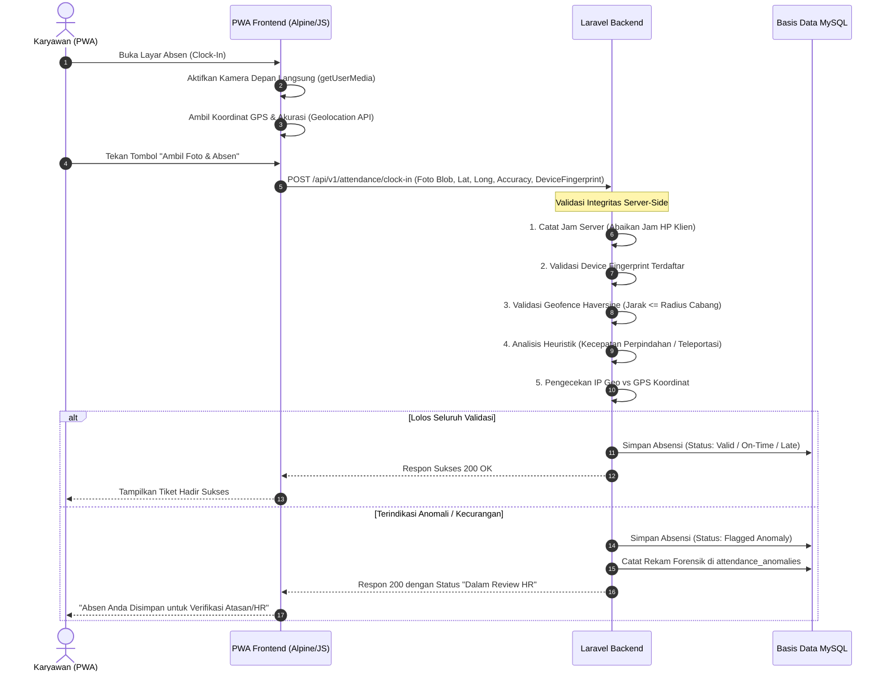

# PRD 06 — MODUL ABSENSI PWA, SHIFT & MESIN ANTI-FRAUD
**Versi:** 1.1.0  
**Tanggal:** 2 Oktober 2026  
**Status:** Disetujui (Telah Direvisi Berdasarkan Review Teknis Web API & Anti-Fraud)  
**Rujukan Dokumen:** [`00_INDEX.md`](file:///d:/ARKIN/tes%20aim/docs/prd/00_INDEX.md), [`02_ARSITEKTUR_DAN_TECH_STACK.md`](file:///d:/ARKIN/tes%20aim/docs/prd/02_ARSITEKTUR_DAN_TECH_STACK.md), [`03_MODEL_DATA_DAN_ERD.md`](file:///d:/ARKIN/tes%20aim/docs/prd/03_MODEL_DATA_DAN_ERD.md)

---

## 1. Deskripsi Modul & Sasaran Fungsional

Modul Absensi dirancang untuk memberikan pencatatan kehadiran instan melalui Progressive Web App (PWA) di ponsel karyawan dengan standar integritas data yang kokoh. Sistem mengandalkan **kombinasi validasi waktu server mutlak, kamera selfie langsung via WebRTC/MediaDevices, batasan radius geofencing per cabang, pengikatan perangkat (device binding), dan algoritma deteksi anomali heuristik**.

---

## 2. Mekanisme Validasi Kehadiran PWA



### 2.1 Batasan Teknis Peramban Web (Web API Constraints)
> [!NOTE]
> Standar W3C Geolocation API pada peramban web (Chrome/Safari) **tidak mengekspos flag `isMock`** (flag tersebut hanya tersedia pada API native Android OS). Oleh karena itu, aplikasi PWA tidak mengklaim deteksi langsung flag mock peramban, melainkan menerapkan **Sistem Deteksi Heuristik Berlapis di Sisi Server**.

---

## 3. Sistem Deteksi Kecurangan Heuristik (PWA Anti-Fraud Engine)

Mengingat aplikasi Fake GPS modern sering kali menyuntikkan koordinat statis dengan akurasi palsu yang "terlalu sempurna", sistem menerapkan 4 pilar heuristik:

| Pilar Deteksi | Logika & Algoritma Sistem | Dampak & Tindakan |
|---|---|---|
| **1. Pengikatan Perangkat (Device Binding)** | Token perangkat unik disimpan di `localStorage` terenkripsi dan dicocokkan dengan `users.device_fingerprint`. Mencegah praktik titip absen di mana 1 smartphone digunakan bergantian oleh banyak orang. | Menolak clock-in dari perangkat baru tanpa persetujuan reset dari HR Admin. |
| **2. Deteksi Kecepatan Perpindahan (Teleportation Check)** | Menghitung kecepatan perpindahan antara dua titik absensi berturutan ($v = \frac{\Delta \text{jarak}}{\Delta \text{waktu}}$). Contoh: Clock-out di Cabang Bekasi pukul 17:00, lalu clock-in di Cabang Jakarta Barat pukul 17:15 ($v > 120\text{ km/jam}$). | Menandai transaksi dengan flag `teleportation_speed` dan mengalihkan status ke **Antrean Review HR**. |
| **3. Analisis Pola Koordinat Statis (Zero-Jitter Heuristic)** | Perangkat GPS fisik selalu memiliki getaran mikro alami (*natural sensor jitter* pada desimal ke-5 atau ke-6 dan akurasi yang berfluktuasi). Jika koordinat berulang kali persis sama hingga desimal ke-8 tanpa variasi. | Memberikan skor risiko anomali sedang (*Medium Anomaly Flag*). |
| **4. Rekonsiliasi Jaringan IP vs GPS** | Membandingkan perkiraan lokasi kota dari IP Address publik pengguna (MaxMind GeoIP) dengan koordinat GPS yang dikirimkan. Jika IP terdeteksi di luar negeri (VPN/Proxy) atau kota berbeda drastis. | Memunculkan peringatan verifikasi tambahan (*Suspicious Network Alert*). |

---

## 4. Mode Bounded Offline (Sinkronisasi Offline Berbatas)

1. **Aktivasi:** Bersifat opsional per tenant/cabang (cocok untuk lokasi terpencil / sinyal buruk).
2. **Penyimpanan:** Data foto selfie terkompresi, koordinat, dan waktu lokal tersimpan aman di IndexedDB perangkat.
3. **Maksimal Masa Sinkronisasi:** Paket wajib disinkronkan dalam waktu maksimal **24 jam**.
4. **Deteksi Time-Drift:** Saat online kembali, server menghitung selisih antara waktu catat lokal dan waktu tiba di server. Selisih waktu yang tidak wajar otomatis ditandai.
5. **Wajib Persetujuan:** Seluruh transaksi dari sinkronisasi offline berstatus `pending_approval` dan wajib diverifikasi oleh Atasan Langsung atau HR sebelum sah dihitung payroll.

---

## 5. Kriteria Penerimaan Fitur (Acceptance Criteria)

### Skenario 1: Clock-In WFO Normal Tepat Waktu
```gherkin
Given Karyawan berada pada jarak 40 meter dari titik pusat kantor cabang (radius batas = 100 meter)
And Ponsel terdaftar sah sebagai perangkat terikat karyawan
When Karyawan mengambil foto selfie live via PWA dan menekan "Absen Masuk" pukul 07:55
Then Sistem mencatat absensi sukses dengan status "On Time"
And Jam server 07:55 tercatat sebagai waktu kehadiran resmi
```

### Skenario 2: Deteksi Anomali Teleportasi Cepat (Fake GPS Heuristic)
```gherkin
Given Karyawan tercatat clock-in di Cabang Surabaya pukul 08:00
When Karyawan yang sama mencoba clock-in di Cabang Malang pukul 08:20 (Jarak 90 km dalam 20 menit, v = 270 km/jam)
Then Server mendeteksi kecepatan perpindahan melampaui batas wajar (> 100 km/jam)
And Transaksi absensi kedua tetap disimpan dengan status "Anomaly Flagged"
And Data langsung masuk ke Antrean Review Anomali HR untuk diverifikasi bukti fisik
And Sistem mengirimkan notifikasi audit ke HR Admin
```

---

## 6. Pertanyaan Terbuka & Keputusan Lanjutan ⚠️

1. **Toleransi Sinyal GPS Indoor:** Di gedung bertingkat tinggi dengan kaca tebal, akurasi GPS peramban sering kali terdegradasi hingga 80–120 meter. Apakah radius toleransi geofence perlu diperlebar menjadi 150 meter khusus kantor di lantai atas?
2. **Kamera Depan Laptop:** Apakah karyawan diizinkan melakukan absensi melalui web browser laptop (menggunakan webcam), atau khusus dibatasi hanya pada peramban smartphone mobile?
