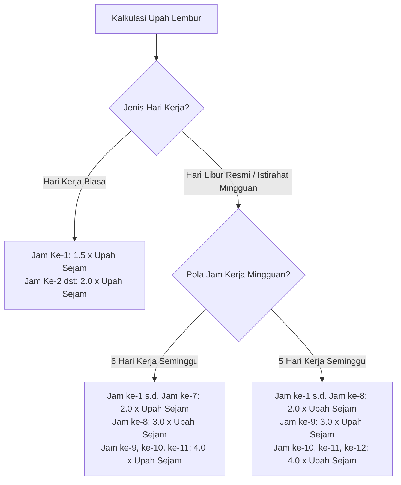

# PRD 07 — MODUL CUTI, LEMBUR & KALENDER PERUSAHAAN
**Versi:** 1.1.0  
**Tanggal:** 2 Oktober 2026  
**Status:** Disetujui (Telah Direvisi Berdasarkan Review Regulasi UU KIA 2024 & PP 35/2021)  
**Rujukan Dokumen:** [`00_INDEX.md`](file:///d:/ARKIN/tes%20aim/docs/prd/00_INDEX.md), [`03_MODEL_DATA_DAN_ERD.md`](file:///d:/ARKIN/tes%20aim/docs/prd/03_MODEL_DATA_DAN_ERD.md), [`06_MODUL_ABSENSI_PWA_SHIFT_ANTI_FRAUD.md`](file:///d:/ARKIN/tes%20aim/docs/prd/06_MODUL_ABSENSI_PWA_SHIFT_ANTI_FRAUD.md)

---

## 1. Deskripsi Modul & Sasaran Fungsional

Modul ini mengelola seluruh siklus pengajuan dan persetujuan waktu istirahat karyawan (cuti tahunan, cuti khusus berbayar, izin sakit, cuti tanpa gaji), penugasan kerja lembur dengan formula ketenagakerjaan resmi Indonesia (**PP 35/2021 & Kepmenakertrans No. 102/2004**), pembaharuan cuti melahirkan sesuai **UU KIA No. 4 Tahun 2024**, serta kalender terpadu perusahaan.

---

## 2. Arsitektur Buku Besar Cuti (Double-Entry Leave Ledger)

Untuk menjamin akuntabilitas saldo kuota, sistem menggunakan tabel transaksi `leave_ledger_transactions`:
* `entitlement_grant`: Pemberian hak cuti awal tahun (misal: $+12.00$ hari).
* `monthly_accrual`: Akrual bulanan bertahap (misal: $+1.00$ hari).
* `leave_taken`: Pemotongan saldo akibat cuti yang disetujui (misal: $-2.00$ hari).
* `leave_cancelled_refund`: Pengembalian saldo jika cuti yang disetujui dibatalkan sebelum hari-H.
* `carry_over_expired`: Pembersihan saldo bawaan yang telah melampaui batas kedaluwarsa.

---

## 3. Kebijakan Cuti Tahunan & Carry-Over

1. **Skema Pemberian Hak:** Konfigurasi per tenant antara **Pemberian di Muka (12 hari di awal tahun)** atau **Akrual Bulanan (1 hari/bulan aktif)**.
2. **Karyawan Baru di Tengah Tahun (Prorata):** Dihitung proporsional berdasarkan sisa bulan aktif.
3. **Carry-Over:** Maksimal hari yang dapat dibawa ke tahun berikutnya (default: 6 hari) dengan batas kedaluwarsa otomatis (misal: hangus per 31 Maret) disertai notifikasi H-30 dan H-7.
4. **Kompensasi Sisa Cuti (Encashment):** Hak penggantian sisa cuti menjadi uang tunai saat pengakhiran hubungan kerja.

---

## 4. Cuti Khusus Berbayar & Pembaruan UU KIA No. 4/2024

Sistem menyediakan master data cuti khusus sesuai hukum ketenagakerjaan Indonesia:

| Jenis Cuti Khusus | Kuota & Aturan Regulasi | Syarat Lampiran Bukti |
|---|---|---|
| **Cuti Melahirkan (Ibu Pekerja) — UU KIA No. 4/2024** | **Hak Dasar: 3 Bulan (Upah 100%)**.<br>**Tambahan hingga 3 Bulan Berikutnya** (total s.d. 6 bulan) untuk kondisi khusus (komplikasi medis ibu atau gangguan kesehatan anak).<br>*Ketentuan Upah:* Bulan 1–4 dibayar 100%, Bulan 5–6 dibayar 75%. | Surat Keterangan Dokter Kandungan / Dokter Anak yang menyatakan kondisi komplikasi medis |
| **Cuti Suami Mendampingi Istri Melahirkan (UU KIA 2024)** | **2 Hari Kerja**, dapat diberikan tambahan paling lama **3 hari berikutnya** atau sesuai kesepakatan kondisi medis. | Surat Keterangan Rumah Sakit / Bidan |
| **Cuti Keguguran Kandungan** | **1,5 Bulan (45 Hari Kalender)** (UU Ketenagakerjaan) | Surat Keterangan Dokter Kandungan |
| **Pernikahan Karyawan** | **3 Hari Kerja** | Buku Nikah / Undangan |
| **Pernikahan Anak Karyawan** | **2 Hari Kerja** | Undangan Pernikahan |
| **Khitanan / Pembaptisan Anak** | **2 Hari Kerja** | Surat Pemberitahuan Acara |
| **Kematian Keluarga Inti (Suami/Istri, Orang Tua/Mertua, Anak)** | **2 Hari Kerja** | Surat Kematian |
| **Kematian Anggota Keluarga dalam 1 Rumah** | **1 Hari Kerja** | Kartu Keluarga & Surat Kematian |
| **Cuti Ibadah Keagamaan (Haji)** | **Hingga 40 Hari Kalender** | Surat Panggilan Resmi Kemenag |
| **Izin Sakit dengan Surat Dokter** | Sesuai durasi istirahat dokter | **Wajib Unggah Foto Surat Dokter** |
| **Cuti Tanpa Gaji (Unpaid Leave)** | Berdasarkan persetujuan HR | Otomatis memotong gaji pokok di payroll |

---

## 5. Modul Lembur Resmi (Koreksi Multiplier PP 35/2021)

### 5.1 Dasar Perhitungan Upah Sejam
$$\text{Upah Sejam} = \frac{1}{173} \times \text{Upah Sebulan (Gaji Pokok + Tunjangan Tetap)}$$

### 5.2 Multiplier Lembur Resmi (Koreksi Sesuai Pasal 31 PP 35/2021)



* **Lembur pada Hari Libur Resmi (Jatuh pada Hari Kerja Terpendek, misal Jumat pada pola 6 hari kerja):**
  * Jam ke-1 s.d. Jam ke-5: $2.0 \times \text{Upah Sejam}$
  * Jam ke-6: $3.0 \times \text{Upah Sejam}$
  * Jam ke-7 dan ke-8: $4.0 \times \text{Upah Sejam}$

---

## 6. Kalender Perusahaan & Libur Nasional Terpadu

* Sinkronisasi berkala dengan Surat Keputusan Bersama (SKB) 3 Menteri untuk Hari Libur Nasional & Cuti Bersama.
* Kemampuan menambahkan Hari Libur Khusus Cabang / Perusahaan.
* **Smart Working-Day Calculation:** Hari libur nasional dan hari libur shift tidak memotong kuota saldo cuti tahunan.

---

## 7. Kriteria Penerimaan Fitur (Acceptance Criteria)

### Skenario 1: Koreksi Perhitungan Lembur Hari Libur Resmi (5 Hari Kerja)
```gherkin
Given Karyawan bekerja dalam pola 5 hari kerja seminggu dengan upah bulanan Rp 5.190.000 (Upah sejam = Rp 30.000)
When Karyawan ditugaskan lembur pada hari Sabtu (hari istirahat mingguan) selama 10 jam dan disetujui
Then Sistem menghitung upah lembur:
  - 8 jam pertama: 8 * 2.0 * Rp 30.000 = Rp 480.000
  - Jam ke-9: 1 * 3.0 * Rp 30.000 = Rp 90.000
  - Jam ke-10: 1 * 4.0 * Rp 30.000 = Rp 120.000
And Total upah lembur hari tersebut sebesar Rp 690.000 masuk ke payroll periode berjalan
```

### Skenario 2: Cuti Melahirkan Kondisi Khusus (UU KIA 2024)
```gherkin
Given Karyawan perempuan mengajukan perpanjangan cuti melahirkan untuk bulan ke-4 dan ke-5
And Melampirkan surat keterangan dokter mengenai komplikasi pasca melahirkan
When HR Admin menyetujui pengajuan cuti melahirkan lanjutan
Then Sistem mencatat status cuti melahirkan dengan upah bulan ke-4 sebesar 100% dan upah bulan ke-5 sebesar 75%
And Kuota cuti tahunan karyawan tidak terpotong sama sekali
```

---

## 8. Pertanyaan Terbuka & Keputusan Lanjutan ⚠️

1. **Pilihan Kebijakan Pembayaran Lembur Karyawan Level Tertentu:** Apakah karyawan pada golongan jabatan manajerial tertentu (*Supervisor / Manager*) berhak mendapatkan uang lembur, atau menggunakan klausul bebas jam kerja (*exempt employees*) sesuai Pasal 27 PP 35/2021?
2. **Kompensasi Cuti Melahirkan oleh BPJS:** Apakah ada rencana integrasi pencatatan bantuan jaminan sosial ketenagakerjaan/kesehatan jika ada subsidi upah cuti melahirkan dari program pemerintah di masa depan?
