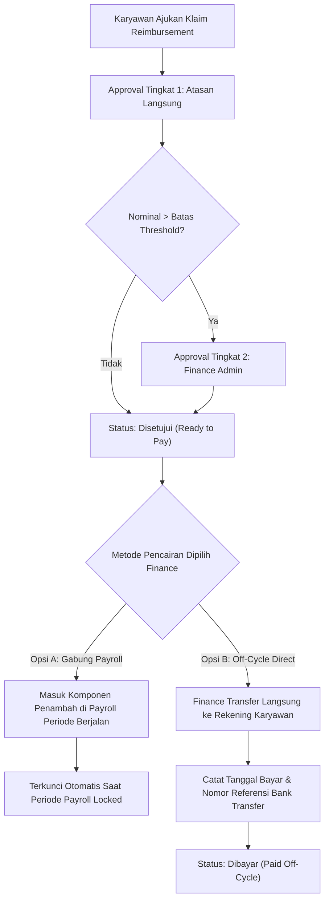

# PRD 09 — MODUL REIMBURSEMENT & MESIN WORKFLOW APPROVAL
**Versi:** 1.0.0  
**Tanggal:** 2 Oktober 2026  
**Status:** Disetujui  
**Rujukan Dokumen:** [`00_INDEX.md`](file:///d:/ARKIN/tes%20aim/docs/prd/00_INDEX.md), [`03_MODEL_DATA_DAN_ERD.md`](file:///d:/ARKIN/tes%20aim/docs/prd/03_MODEL_DATA_DAN_ERD.md), [`08_MODUL_PAYROLL_PAJAK_BPJS_BANK.md`](file:///d:/ARKIN/tes%20aim/docs/prd/08_MODUL_PAYROLL_PAJAK_BPJS_BANK.md)

---

## 1. Deskripsi Modul & Sasaran Fungsional

Modul ini mengelola dua pilar penting dalam operasional perusahaan:
1. **Penggantian Biaya (Reimbursement & Advance):** Pengajuan klaim operasional, transportasi, medis, dan dana dinas luar dengan verifikasi bukti transaksi digital dan kontrol plafon anggaran.
2. **Mesin Alur Persetujuan (Unified Approval Engine):** Sistem persetujuan 2-tingkat terpusat yang melayani pengajuan cuti, lembur, koreksi absensi, dan reimbursement, dilengkapi aturan batas nominal (*threshold*), delegasi wewenang saat cuti, serta eskalasi otomatis.

### 1.1 User Stories Utama
1. **Sebagai Karyawan,** saya ingin mengajukan klaim pengeluaran dengan memotret struk via ponsel, melihat sisa plafon hak klaim saya tahun ini, dan memantau status persetujuan secara real-time.
2. **Sebagai Line Manager,** saya ingin meninjau pengajuan klaim dan izin dari bawahan langsung saya melalui ponsel, serta mendelegasikan wewenang persetujuan kepada rekan manajer lain saat saya sedang cuti.
3. **Sebagai Finance Admin,** saya ingin menerima pengajuan klaim bernominal besar yang telah disetujui atasan, memilih metode pencairan (transfer langsung off-cycle atau digabung ke slip gaji bulanan), dan mencatat nomor referensi transfer bank sebagai bukti audit.

---

## 2. Pengelolaan Kategori Klaim & Kontrol Plafon

### 2.1 Kategori Klaim Fleksibel
Sistem menyediakan konfigurasi kategori klaim dengan atribut:
* **Transportasi & Bahan Bakar:** Penggantian bensin, tol, parkir, dan taksi dinas.
* **Kesehatan & Medis (Rawat Jalan/Kacamata/Gigi):** Tunjangan kesehatan di luar BPJS dengan plafon tahunan.
* **Makan & Jamuan Klien (Entertainment):** Wajib menyertakan nama klien dan tujuan bisnis.
* **Perlengkapan & Operasional Proyek:** Pembelian barang habis pakai kantor atau alat kerja lapangan.
* **Komunikasi (Pulsa & Paket Data):** Tunjangan komunikasi berbasis jabatan.

### 2.2 Aturan Plafon & Validasi Bukti Struk
1. **Plafon Berbasis Jabatan / Golongan (Job Grade):** Setiap kategori memiliki batas klaim bulanan atau tahunan yang disesuaikan dengan level jabatan (misal: Staff Transportasi Rp 500.000/bln; Manager Rp 2.000.000/bln).
2. **Visibilitas Plafon Real-Time:** Karyawan dapat melihat akumulasi pemakaian bulan berjalan dan sisa plafon aktif langsung pada formulir pengajuan di PWA.
3. **Batas Usia Struk (Receipt Age Limit):** Sistem menolak pengajuan jika tanggal transaksi pada kuitansi/struk telah melampaui **30 hari kalender** sejak tanggal pembelian (dapat disesuaikan di `company_settings`).
4. **Deteksi Struk Duplikat (Duplicate Receipt Alert):** Sistem mendeteksi jika tanggal, nominal, dan nama merchant sama persis dengan klaim yang pernah diajukan sebelumnya dalam rentang 60 hari untuk mencegah klaim ganda.
5. **Perlakuan Pajak PPh 21:** Setiap kategori klaim memiliki flag konfigurasi `is_taxable`:
   * Biaya penggantian riil operasional (*at cost*): **Bebas Pajak**.
   * Tunjangan fasilitas/natura tertentu di atas batas regulasi PMK: **Objek Pajak PPh 21**.

---

## 3. Dua Metode Pencairan Klaim (Disbursement Flow)



* **Pencairan Masuk Payroll (On-Cycle):** Klaim yang disetujui ditarik ke dalam draf payroll bulan bersangkutan dan dibayarkan serentak pada tanggal gajian.
* **Pencairan Langsung (Off-Cycle):** Untuk pengeluaran mendesak, Finance dapat mencairkan dana via transfer perbankan kapan saja tanpa menunggu siklus gajian, lalu menginput tanggal bayar dan nomor referensi bukti transfer pada sistem.

---

## 4. Modul Uang Muka Operasional (Cash Advance & Settlement)

1. **Pengajuan Dana Kasbon Dinas (Travel Advance):** Karyawan mengajukan estimasi dana sebelum bepergian dinas ke luar kota $\rightarrow$ Approval Atasan & Finance $\rightarrow$ Dana dicairkan oleh Finance.
2. **Penyelesaian Biaya Realisasi (Expense Settlement):** Maksimal 5 hari kerja setelah kembali dari penugasan, karyawan mengunggah seluruh nota riil pada formulir settlement.
3. **Penyelesaian Selisih (Delta Reconciliation):**
   * **Selisih Kurang (Realisasi > Uang Muka):** Perusahaan membayarkan kekurangan dana kepada karyawan.
   * **Selisih Lebih (Realisasi < Uang Muka):** Karyawan mengembalikan sisa dana tunai/transfer ke rekening perusahaan, atau jika tidak diselesaikan dalam 14 hari, sistem otomatis memotongnya dari gaji bulan berikutnya.

---

## 5. Mesin Persetujuan 2-Tingkat Terpadu (Unified Approval Engine)

Mesin persetujuan dirancang untuk melayani seluruh modul pengajuan (cuti, izin sakit, lembur, koreksi absensi, dan reimbursement) dengan tata kelola yang ketat:

### 5.1 Matriks Aturan Approval per Tipe Pengajuan

| Jenis Pengajuan | Tingkat 1 (Level 1) | Tingkat 2 (Level 2) | Fallback / Pengecualian |
|---|---|---|---|
| **Cuti Tahunan / Khusus** | Atasan Langsung | HR Admin | Jika tanpa atasan $\rightarrow$ Langsung ke HR Admin |
| **Izin Sakit (> 1 hari)** | Atasan Langsung | HR Admin (Verifikasi Surat Dokter) | Jika tanpa atasan $\rightarrow$ Langsung ke HR Admin |
| **Lembur (SPKL)** | Atasan Langsung | HR Admin (Validasi Anggaran) | Jika tanpa atasan $\rightarrow$ Langsung ke HR Admin |
| **Koreksi Absensi (Lupa Absen)** | Atasan Langsung | HR Admin | Jika tanpa atasan $\rightarrow$ Langsung ke HR Admin |
| **Reimbursement $\le \text{Threshold}$** | Atasan Langsung | Selesai (Auto-Approve Tingkat 2) | Cukup persetujuan Atasan Langsung |
| **Reimbursement $> \text{Threshold}$** | Atasan Langsung | **Finance Admin** | Wajib verifikasi kelengkapan bukti oleh Finance |

*Batas Threshold (misal: Rp 1.000.000) dapat dikonfigurasi dinamis per cabang/perusahaan.*

### 5.2 Fitur Delegasi Wewenang (Approval Delegation)
* Saat seorang Line Manager mengambil cuti atau dinas luar negeri, manajer dapat mengaktifkan **Mode Delegasi** di menu profilnya.
* Manajer menentukan: Nama Pejabat Pelaksana (rekan manajer sederajat) dan rentang tanggal berlakunya delegasi.
* Selama masa delegasi, notifikasi persetujuan pengajuan bawahan otomatis diteruskan kepada pejabat pelaksana, dengan tembusan (CC) audit log ke manajer utama.

### 5.3 Eskalasi SLA Otomatis (Auto-Escalation)
* Pengajuan yang tidak direspons (status `pending`) dalam waktu **$2 \times 24$ jam kerja**:
  * Sistem mengirimkan pesan pengingat mendesak (*Reminder Alert*) ke WhatsApp dan Email approver.
* Jika dalam **$3 \times 24$ jam kerja** tetap tidak ditindaklanjuti:
  * Tiket persetujuan otomatis dieskalasikan ke atasan dari approver tersebut (*Grand-Manager*) atau HR Admin untuk mencegah kemacetan proses operasional.

---

## 6. Kriteria Penerimaan Fitur (Acceptance Criteria)

### Skenario 1: Reimbursement Melebihi Batas Threshold Nominal
```gherkin
Given Batas threshold approval reimbursement diatur sebesar Rp 1.000.000
And Karyawan "Agus" mengajukan klaim perjalanan dinas sebesar Rp 1.750.000 disertai foto struk tiket pesawat
When Atasan Langsung menyetujui pengajuan tersebut
Then Status pengajuan berubah menjadi "Approved Level 1 (Pending Finance)"
And Notifikasi penugasan verifikasi dikirimkan ke antrean Finance Admin
When Finance Admin memeriksa bukti dan menekan tombol "Approve Final"
Then Status pengajuan berubah menjadi "Ready for Disbursement"
```

### Skenario 2: Penolakan Klaim Akibat Struk Kedaluwarsa
```gherkin
Given Tanggal pengajuan hari ini adalah 2 Oktober 2026
And Karyawan mencoba mengunggah struk pembelian bertanggal 15 Agustus 2026 (usia struk 48 hari)
When Karyawan menekan tombol "Kirim Pengajuan"
Then Sistem menampilkan pesan kesalahan "Struk telah kedaluwarsa (> 30 hari). Pengajuan klaim ditolak sesuai kebijakan perusahaan."
And Pengajuan tidak dapat disimpan ke basis data
```
