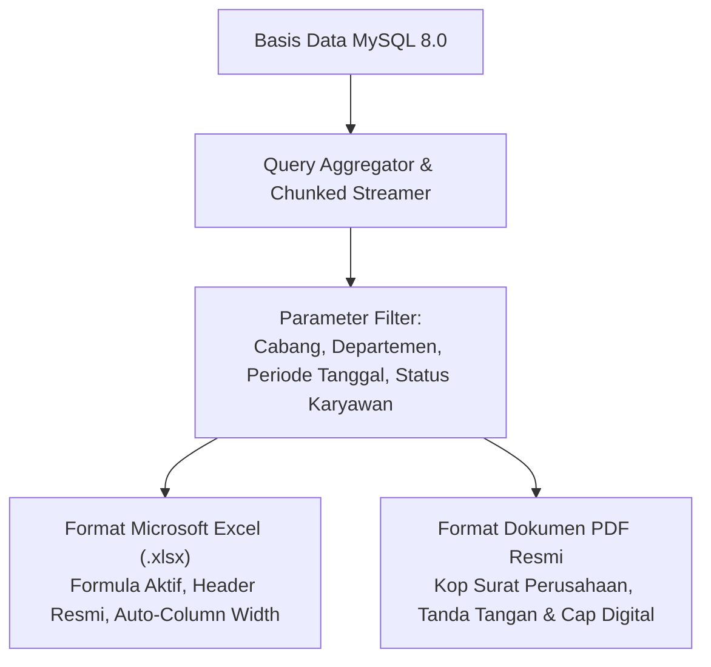

# PRD 11 — LAPORAN, DASBOR EKSEKUTIF & AUDIT FORENSIK
**Versi:** 1.0.0  
**Tanggal:** 2 Oktober 2026  
**Status:** Disetujui  
**Rujukan Dokumen:** [`00_INDEX.md`](file:///d:/ARKIN/tes%20aim/docs/prd/00_INDEX.md), [`04_RBAC_KEAMANAN_DAN_UU_PDP.md`](file:///d:/ARKIN/tes%20aim/docs/prd/04_RBAC_KEAMANAN_DAN_UU_PDP.md), [`08_MODUL_PAYROLL_PAJAK_BPJS_BANK.md`](file:///d:/ARKIN/tes%20aim/docs/prd/08_MODUL_PAYROLL_PAJAK_BPJS_BANK.md)

---

## 1. Deskripsi Modul & Sasaran Bisnis

Modul Laporan dan Dasbor menyediakan visibilitas operasional *real-time* kepada manajemen puncak, HR, Finance, dan Manager lini untuk mengambil keputusan berbasis data yang akurat. Modul ini mencakup ringkasan visual metrik utama, rekapitulasi operasional mendalam yang dapat diekspor ke lembar kerja Excel/PDF resmi, serta pusat penelusuran rekam jejak audit (*forensic audit trail*).

---

## 2. Dasbor Khusus Berbasis Peran (Role-Based Dashboards)

Setiap pengguna disajikan dasbor yang dipersonalisasi sesuai wewenang jabatannya:

### 2.1 Dasbor HR Admin & Super Admin
* **Widget Kehadiran Real-Time Hari Ini:**
  * Total Karyawan Aktif vs Total Hadir Tepat Waktu, Terlambat, Izin/Sakit, Cuti, Dinas Luar, dan Alpha (Belum Hadir).
* **Widget Peringatan Kritis Ketenagakerjaan:**
  * Kontrak PKWT Mendekati Habis (Filter: $\le 60$ hari, $\le 30$ hari, $\le 7$ hari).
  * Karyawan Mendekati Batas Akhir Evaluasi Probation.
* **Widget Antrean Tugas HR (Actionable Items):**
  * Jumlah Absensi Terindikasi Anomali (Fake GPS / Offline Drift) yang membutuhkan verifikasi.
  * Permohonan Reset Device Binding Karyawan.
  * Pengajuan Koreksi Absensi / Lupa Absen dari Karyawan.
* **Widget Metrik SDM:** Tren pergantian karyawan (*Turnover Rate*) kuartalan dan demografi tenaga kerja.

### 2.2 Dasbor Line Manager
* **Status Tim Hari Ini:** Daftar nama staf di bawah divisinya yang hadir, jam clock-in, dan staf yang sedang izin/cuti.
* **Kalender Ketersediaan Tim:** Matriks visual per hari untuk memantau rencana cuti bawahan.
* **Antrean Persetujuan Pending:** Pintasan cepat untuk menyetujui lembur, cuti, tukar shift, dan reimbursement bawahan.

### 2.3 Dasbor Finance Admin
* **Ringkasan Beban Penggajian Periode Berjalan:** Total Gaji Bruto, Estimasi Pajak PPh 21 Terutang, Beban Iuran BPJS Perusahaan, dan Total Gaji Bersih yang Harus Dicairkan.
* **Status Klaim & Kasbon:** Total reimbursement menunggu pembayaran off-cycle dan rekap sisa piutang pinjaman karyawan.
* **Status Rekonsiliasi Bank:** Daftar batch transfer gaji yang telah diunduh dan diproses.

---

## 3. Katalog Laporan Standar & Ekspor



### 3.1 Laporan Rekapitulasi Absensi Bulanan (Attendance Matrix)
* Format tabel matriks di mana kolom menampilkan tanggal 1 hingga 31 dalam satu bulan periode cut-off.
* Simbol status per sel: `H` (Hadir), `T` (Terlambat + menit keterlambatan), `S` (Sakit), `C` (Cuti), `I` (Izin), `A` (Alpha), `OFF` (Libur).
* Kolom agregat akhir: Total Hari Kerja, Total Hadir, Total Menit Keterlambatan, Akumulasi Denda.

### 3.2 Laporan Rekapitulasi Penggajian & PPh 21
* Laporan penggajian komprehensif yang memuat rincian setiap karyawan: Gaji Pokok, Tunjangan, Lembur, Denda, Premi BPJS TK (JKK, JKM, JHT, JP), BPJS Kesehatan, Kategori TER, Tarif TER (%), Nilai PPh 21, Potongan Pinjaman, hingga Gaji Bersih.
* Baris total rekapitulasi di bagian bawah untuk validasi audit tim Finance.

### 3.3 Laporan Iuran BPJS (Format Pelaporan BPJS TK & Kes)
* Dokumen siap pakai untuk rekonsiliasi dengan aplikasi SIPP Online BPJS Ketenagakerjaan dan Edabu BPJS Kesehatan.

---

## 4. Penelusuran Jejak Audit Forensik (Forensic Audit Trail)

Untuk memenuhi standar keamanan dan prinsip akuntabilitas UU PDP:
1. **Antarmuka Audit Log:** Menampilkan seluruh log aktivitas dengan fitur filter lanjutan:
   * Rentang waktu kejadian.
   * Nama pelaku (*actor*).
   * Modul / Tipe Entitas (misal: `Employee`, `PayrollItem`, `LeaveRequest`).
   * Alamat IP dan Perangkat (*User-Agent*).
2. **Modal Inspeksi Perubahan (Diff Viewer):** Menampilkan perbandingan sebelum (*old value*) dan sesudah (*new value*) dengan penanda warna visual (merah untuk data lama, hijau untuk data baru).
3. **Pencatatan Akses Data Sensitif (Read Audit Log):** Setiap kali HR Admin atau Finance mengklik ikon "Buka/Lihat Gaji Pokok Karyawan" atau mengekspor data NIK/rekening massal, sistem secara otomatis mencatat event `view_sensitive_data` di audit log untuk mencegah penyalahgunaan wewenang internal.

---

## 5. Kriteria Penerimaan Fitur (Acceptance Criteria)

### Skenario 1: Ekspor Rekap Absensi Bulanan ke Format Excel
```gherkin
Given HR Admin membuka menu "Laporan Absensi"
And Memilih Cabang "Kantor Pusat Jakarta" dan Periode "21 September 2026 s.d. 20 Oktober 2026"
When HR Admin menekan tombol "Ekspor Excel (.xlsx)"
Then Sistem menghasilkan berkas Excel dalam waktu kurang dari 3 detik
And Berkas memuat matriks kehadiran harian seluruh karyawan cabang tersebut beserta total akumulasi keterlambatan dan denda yang akurat
```

### Skenario 2: Penelusuran Perubahan Nominal Gaji di Audit Log
```gherkin
Given Terjadi penyesuaian gaji pokok pada karyawan "Dewi" oleh HR Admin
When Super Admin membuka menu "Audit Trail Forensik" dan mencari entitas karyawan "Dewi"
Then Sistem menampilkan catatan kejadian:
  - Waktu kejadian tepat
  - Nama dan ID HR Admin yang melakukan perubahan
  - Nilai gaji lama vs nilai gaji baru
  - Catatan nomor SK promosi yang menjadi alasan perubahan
```
