# PRD 14 — PANDUAN IMPLEMENTASI, TESTING & DEPLOYMENT aaPANEL
**Versi:** 1.1.0  
**Tanggal:** 2 Oktober 2026  
**Status:** Disetujui (Telah Direvisi: Koreksi Urutan Build Dependensi & Test Case Finansial)  
**Rujukan Dokumen:** [`00_INDEX.md`](file:///d:/ARKIN/tes%20aim/docs/prd/00_INDEX.md), [`02_ARSITEKTUR_DAN_TECH_STACK.md`](file:///d:/ARKIN/tes%20aim/docs/prd/02_ARSITEKTUR_DAN_TECH_STACK.md), [`03_MODEL_DATA_DAN_ERD.md`](file:///d:/ARKIN/tes%20aim/docs/prd/03_MODEL_DATA_DAN_ERD.md)

---

## 1. Urutan Bangun Modul Bebas Regresi (Corrected Build Order)

Merespons evaluasi dependensi bahwa modul Cuti, Lembur, dan Reimbursement membutuhkan Mesin Persetujuan (*Approval Engine*) dan Notifikasi untuk dapat berfungsi, urutan implementasi kode disempurnakan menjadi:

```mermaid
flowchart TD
    P1["Langkah 1: Fondasi Proyek\nLaravel 11, Livewire 3, Tailwind, MySQL 8, Redis"] --> P2["Langkah 2: Auth, RBAC, Enkripsi & Blind Index\nUser Model, Sanctum, HMAC Blind Index NIK, Audit Trail"]
    P2 --> P3["Langkah 3: Master Data & Organisasi\nCompany Settings, Cabang Geofence, Divisi, Departemen, Jabatan"]
    P3 --> P4["Langkah 4: Manajemen Karyawan & Kontrak\nEmployee Master, Kontrak PP 35/2021, Generator SK"]
    P4 --> P5["Langkah 5: Unified Approval Engine & Delegasi\nAturan 2-Tingkat, Threshold Limit, Delegasi & Eskalasi SLA"]
    P5 --> P6["Langkah 6: Notifikasi Multi-Kanal\nIn-App Bell, SMTP, Fonnte Adapter, Jitter Queue Redis"]
    P6 --> P7["Langkah 7: Absensi PWA, Shift & Anti-Fraud\nCamera API, Jam Server, Haversine, Shift, Bounded Offline"]
    P7 --> P8["Langkah 8: Cuti (Ledger), Lembur & Kalender\nDouble-Entry Ledger, Overtime Depnaker, UU KIA 2024, Libur SKB"]
    P8 --> P9["Langkah 9: Mesin Payroll, Pajak TER, BPJS & Bank\nPPh 21 TER, Rekalkulasi Des, BPJS, THR, Kasbon, Bank Export"]
    P9 --> P10["Langkah 10: Reimbursement & Cash Advance\nPlafon Jabatan, Bukti Struk, Settlement, Pencairan Off-Cycle"]
    P10 --> P11["Langkah 11: Laporan, Dasbor & Audit Log Forensik\nMatrix Absensi Excel, Dashboard Widgets, Forensic Diff Viewer"]
```



---

## 2. Strategi Pengujian Otomatis (Testing Strategy)

Pengujian kode wajib mencakup cakupan unit testing pada formula kalkulasi finansial dan kepatuhan hukum menggunakan **Pest PHP / PHPUnit**:

### 2.1 Pengujian Unit Finansial & Regulasi Ketenagakerjaan
1. **Tes Formula PPh 21 TER (PP 58/2023):**
   * Verifikasi pemetaan tarif TER Kategori A, B, dan C.
   * *Uji Kritis:* Penghasilan Bruto Rp 10.423.200 (Kategori TER A) terpetakan pada tarif **2.50%** menghasilkan potongan **Rp 260.580**.
   * Verifikasi rekalkulasi Pasal 17 pada masa Desember (selisih lebih/kurang potong).
2. **Tes Formula Lembur Resmi (PP 35/2021):**
   * *Pola 5 Hari Kerja:* 8 jam pertama dibayar 2x upah sejam, jam ke-9 dibayar 3x, jam ke-10 s.d. ke-12 dibayar 4x.
   * *Pola 6 Hari Kerja:* 7 jam pertama dibayar 2x upah sejam, jam ke-8 dibayar 3x, jam ke-9 s.d. ke-11 dibayar 4x.
3. **Tes Uang Kompensasi PKWT (PP 35/2021):**
   * Uji masa kerja proporsional: $(\text{Masa Kerja}/12) \times \text{Upah}$.
   * Uji penolakan sistem jika total akumulasi masa kerja PKWT melampaui 60 bulan (5 tahun).
4. **Tes Cuti Melahirkan (UU KIA 2024):**
   * Uji hak dasar 3 bulan (upah 100%).
   * Uji perpanjangan hingga 3 bulan tambahan dengan upah bulan ke-4 100% dan bulan ke-5 s.d. ke-6 75%.
5. **Tes Blind Index NIK:**
   * Memastikan hash HMAC-SHA256 konsisten dan pencarian data karyawan via `nik_bidx` menghasilkan record yang tepat.

---

## 3. Panduan Deployment Produksi di VPS aaPanel

1. **Stack yang Terpasang:** Nginx 1.24+, MySQL 8.0+, PHP 8.3 dengan ekstensi `pdo_mysql`, `redis`, `bcmath`, `fileinfo`, `gd`, `intl`, `zip`, `pcntl`, `posix`, dan Redis Server 7.x.
2. **Konfigurasi Nginx:** Client Max Body Size 20M, SSL Let's Encrypt, HTTP/2, Caching PWA statis.
3. **Konfigurasi Task Scheduler di aaPanel Cron:**
   ```bash
   cd /www/wwwroot/hris && /www/server/php/83/bin/php artisan schedule:run >> /dev/null 2>&1
   ```
4. **Konfigurasi Daemon Supervisor:**
   * Jalankan worker Redis: `php artisan queue:work redis --sleep=3 --tries=3 --timeout=90`.
5. **Pencadangan Mandiri `APP_KEY` & `BLIND_INDEX_KEY`:** Simpan salinan di brankas kata sandi independen.

---

## 4. Pertanyaan Terbuka & Keputusan Lanjutan ⚠️

1. **Strategi Migrasi Data Awal (Data Onboarding):** Apakah migrasi data karyawan dari spreadsheet Excel lama akan dibantu dengan script seeder migrasi sekali jalan (*one-time onboarding seeder*) atau melalui antarmuka web importer massal? Disarankan membuat template Excel importer resmi.
2. **Automasi Pembaruan Kode (CI/CD):** Apakah proses rilis pembaruan kode ke VPS aaPanel akan menggunakan Git Hook otomatis (*GitHub Actions / Webhook deploy*) atau manual pull oleh sysadmin?
